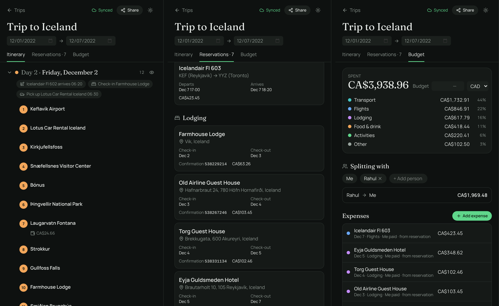
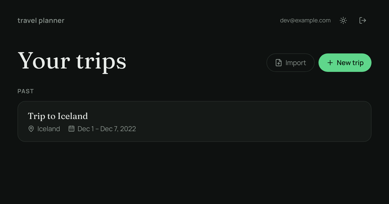
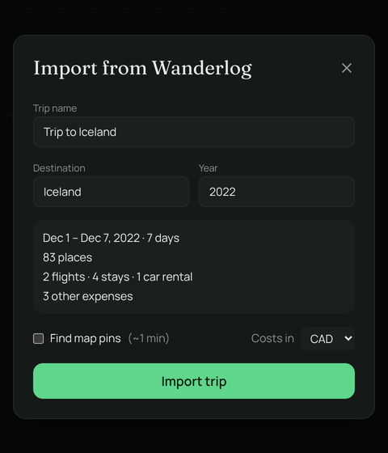
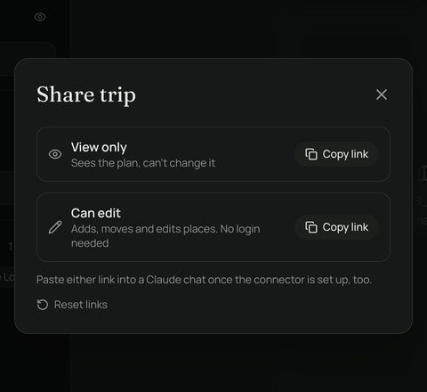
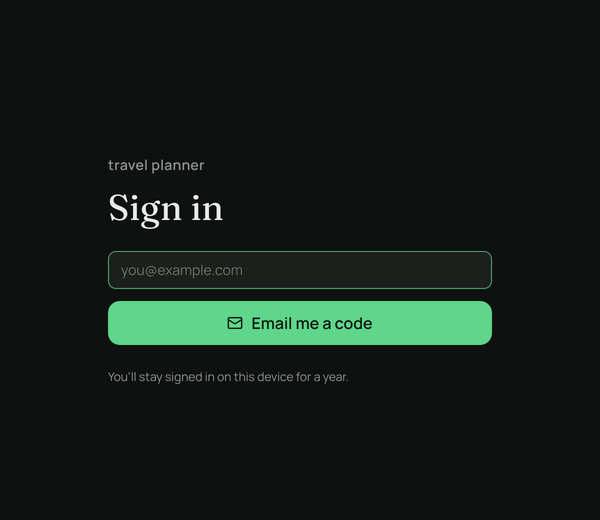

<p></p>

# Atlas Journeys

A trip planner I built to replace Wanderlog. Works offline, syncs live between devices, and has no paywall.

**Live:** [adityajain.ca/travelplanner](https://adityajain.ca/travelplanner)



## Features

- **Itinerary:** days from the trip dates plus free lists ("Places to visit", restaurants). Drag stops between days, add notes and checklists anywhere.
- **Map:** dark vector map with numbered pins per day, satellite toggle, and real routes between stops (drive, walk, bike, transit) with times on each leg.
- **Places:** OpenStreetMap search with Google as a fallback. Opening a stop shows its photo, Wikipedia summary, hours and rating; Google details are cached so they work offline.
- **Reservations and budget:** flights, hotels, cars, trains and restaurants, plus a budget with categories, multi-currency, who paid, and settle-up.
- **Offline:** installable PWA. Trips live on the device, and you can download the map for a trip's area.
- **Sharing:** view or edit links that work without an account. Resetting them revokes every old link.
- **Getting trips in:** import a Wanderlog PDF (parsed in the browser), or forward booking emails to `trips@adityajain.ca` and review what Claude pulled out of them.
- **Claude connector:** an MCP server, so Claude can read or edit a trip from its share link.

<table>
  <tr>
    <td width="50%"></td>
    <td width="50%"></td>
  </tr>
  <tr>
    <td></td>
    <td></td>
  </tr>
</table>

## How it's built

| | |
| --- | --- |
| App | React 19, Vite, Tailwind 4, `vite-plugin-pwa`, served under `/travelplanner/` |
| Trip data | One Yjs document per trip, stored in IndexedDB. Dexie for device-only data (map regions, route and rate caches). |
| Sync | A Durable Object per trip speaking the y-websocket protocol, with a D1 index |
| Auth | Email code from the Worker, 1-year rolling session cookie |
| Share links | HMAC-signed view/edit tokens; reset bumps a version |
| Map | MapLibre with Protomaps vector tiles, MapTiler satellite |
| Search and routing | Photon/Nominatim, Google Places; OSRM for drive/walk/bike, Transitous then Google for transit |
| Email import | Cloudflare Email Routing → Worker → Claude Haiku extraction → review inbox |
| Claude | Stateless MCP server at `/travelplanner/mcp`; the share link is the credential |

Code that changes a trip goes through `src/lib/trips.ts`.

## Run it locally

```bash
npm install
npm run dev        # http://localhost:5173/travelplanner/
npm run typecheck
```

The map and sync need API keys and a running Worker.

## Using the Claude connector

1. In Claude, add a custom connector with the URL `https://adityajain.ca/travelplanner/mcp`.
2. Leave `get_trip` and `search_places` always allowed; set the edit tools to require approval.
3. Paste a trip's share link into a chat. A view link lets Claude read; an edit link lets it make changes, which show up live in the app.

To import an old Wanderlog trip this way, attach the PDF from Wanderlog's "Print this trip" along with an edit link and ask Claude to import it.

## Credits

Map data © OpenStreetMap contributors, Protomaps, MapTiler. Search: Photon, Nominatim. Routing: FOSSGIS OSRM, [Transitous](https://transitous.org/sources/). Exchange rates: ECB via Frankfurter. Photos: Unsplash, Wikipedia, Wikimedia Commons, Openverse.
